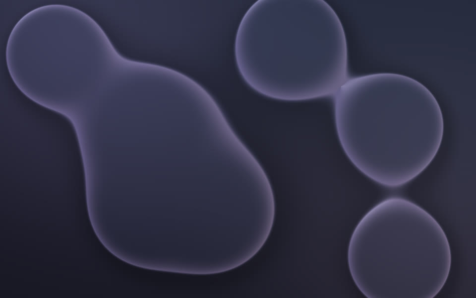

# Mural

Live wallpapers for Linux. Shaders, videos and pictures, behind your windows, on whatever
desktop you run.


- **Shaders** that take their colours from your theme (pywal, or a [wire](https://github.com/dork40/hyprland-rice) rice), so they match the rest of your desktop
- **Videos** that loop without a hitch and never make a sound. Decoded on the GPU when it can.
- **Pictures**: JPG, PNG, WebP, AVIF, HEIC, JPEG XL, and animated GIFs
- **Gets out of the way.** It pauses when a game or a fullscreen app is up, when GameMode is on,
  or on battery if you want. Paused means 0% CPU.
- One wallpaper per screen, or the same one everywhere

| | | |
|---|---|---|
|  Starfield |  Nebula |  Liquid Glass |
|  Soft Gradient |  any video | |

## Install

```sh
curl -fsSL https://raw.githubusercontent.com/dork40/mural/main/install.sh | bash
```

It pulls in what's needed from your distro's own repos (Arch, Fedora, Debian/Ubuntu,
openSUSE, Bazzite/Silverblue), installs Mural into `~/.local`, and starts it with your desktop.
Read the script first if you like, it's short. `install.sh --uninstall` takes it back out.

## Use

```sh
mural list                        # everything you can pick
mural set nebula                  # a built-in shader
mural set ~/Videos/rain.mp4       # a video
mural set ~/Pictures/hills.jpg    # a picture
mural set liquid --screen HDMI-A-1
mural pause / resume / toggle
mural status
```

Window managers without autostart (Hyprland, Sway, i3, ...) need one line in their config:
`exec-once = mural start` (Sway and i3: `exec mural start`).

Drop videos and pictures into `~/.local/share/mural/wallpapers/` and they show up in `mural list`.

## Where it works

| Desktop | How it sits behind your windows | Pauses for fullscreen |
|---|---|---|
| Hyprland, Sway, river, niri, Wayfire, labwc | wlr-layer-shell background layer | Hyprland, Sway |
| KDE Plasma (Wayland) | layer-shell, just above Plasma's own wallpaper | yes (small KWin helper script) |
| XFCE, i3, bspwm, Openbox, KDE on X11, other X11 desktops | a desktop window under everything | yes |
| GNOME | the bundled Mural GNOME Shell extension (installed for you) | yes |

Pausing when a game is focused works on Hyprland, Sway/i3 and X11. GameMode pausing works
everywhere.

## Settings

`~/.config/mural/config.json`. Mural picks up changes as soon as you save.

```json
{
  "wallpaper": "shader:aurora",
  "monitors": { "HDMI-A-1": "file:/home/me/Videos/rain.mp4" },
  "fps": 30,
  "colors": "auto",
  "pause_on_fullscreen": true,
  "pause_on_game": true,
  "pause_on_gamemode": true,
  "pause_on_battery": false
}
```

## Write your own shader

Put a `.frag` file in `~/.local/share/mural/shaders/`. If you've used Shadertoy, the names
will look familiar:

```glsl
// Name: Pulse
// iTime, iResolution, uAccent1..3, uBackground and fragColor are declared for you
void main() {
    vec2 uv = gl_FragCoord.xy / iResolution.xy;
    fragColor = vec4(mix(uBackground, uAccent1, 0.5 + 0.5 * sin(iTime + uv.x * 6.0)), 1.0);
}
```

Add `// Scale: 0.5` near the top to draw at half resolution, which is easy on the GPU for soft
shaders.

## How heavy is it?

Measured on a Ryzen laptop with a Radeon RX 7700S, 1920×1200:

| | CPU | GPU |
|---|---|---|
| Shaders | ~3% | 4–8% |
| 1080p video | ~4% | hardware decode |
| Picture | 0% | 0% |
| Paused | 0% | 0% |

## License

GPL-3.0-or-later. The built-in shaders are original, and so are the shots above. The test
video comes from NASA (public domain).
