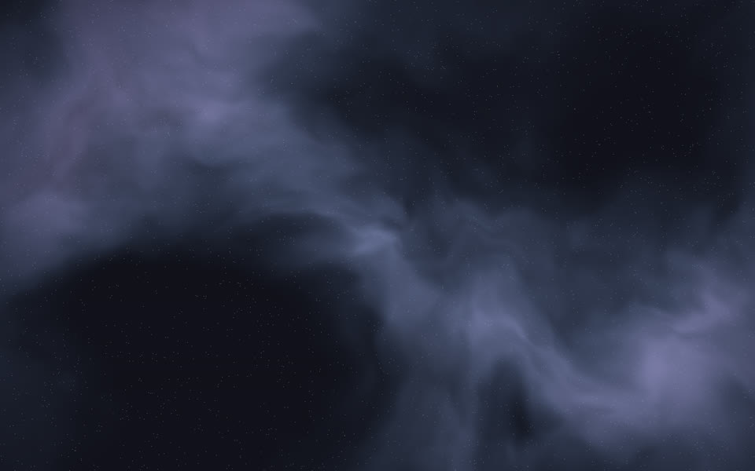
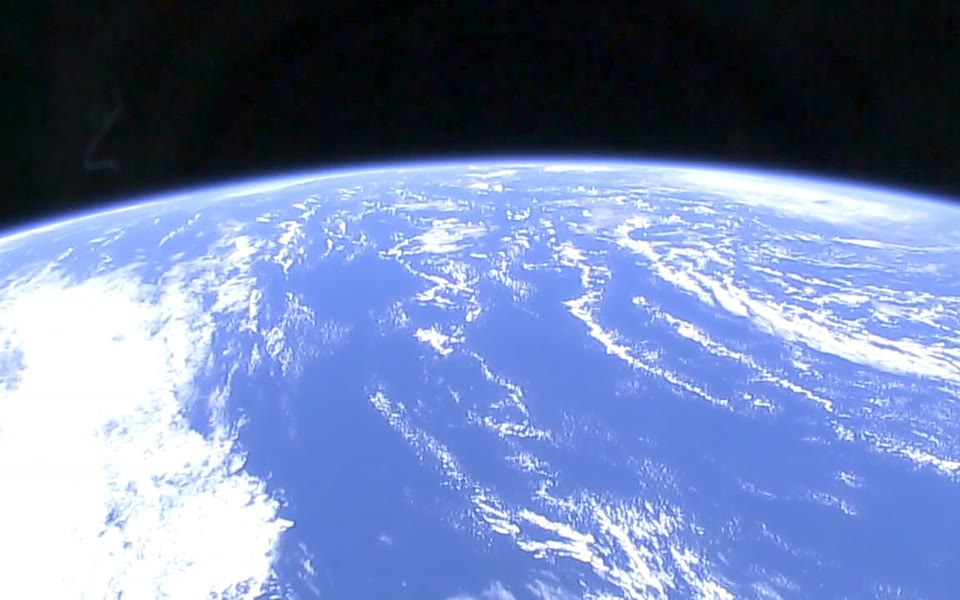

# Mural

Live wallpapers for Linux. Animated wallpapers, videos and images, behind your windows, on
whatever desktop you run.


- **Animated wallpapers** that take their colours from your theme (pywal, or a [wire](https://github.com/dork40/hyprland-rice) rice), so they match the rest of your desktop
- **Videos** that loop without a hitch and never make a sound
- **Images**: JPG, PNG, WebP, AVIF, HEIC, JPEG XL, and animated GIFs
- **Gets out of the way.** It pauses by itself for games, fullscreen apps and GameMode, and on
  battery if you want. Paused means no CPU or GPU use at all.
- A different wallpaper on each screen, if you like

| | | |
|---|---|---|
|  Aurora |  Nebula |  Liquid Glass |
|  Starfield |  Soft Gradient |  your own videos |

## Install

Arch and Arch-based:

```sh
curl -sL dork40.github.io/mural | bash
```

Fedora, Ubuntu, Debian, openSUSE:

```sh
curl -fsSL https://raw.githubusercontent.com/dork40/mural/main/install.sh | bash
```

Then open **Mural** from your app menu.

## Using it

- Click a wallpaper to put it on your desktop.
- Hover an animated one to see it move.
- **+** (or drag files onto the window) adds your own videos and images. Right-click one to
  remove it.
- The pause button freezes the wallpaper. The line under the title tells you if it paused by
  itself, and why.
- With more than one screen, pick the screen at the top left before you click a wallpaper.
- **Preferences** (in the menu): match your theme's colours, smoothness, when to pause, and
  starting with your desktop.

## Where it works

Tested on Hyprland, Sway, i3, KDE Plasma, XFCE and GNOME. It should also work on niri, river,
Wayfire, labwc, Openbox and other X11 desktops. On GNOME, Mural adds a small Shell extension;
log out and back in once after installing.

## How heavy is it?

Measured on a Ryzen laptop with a Radeon RX 7700S, 1920×1200:

| | CPU | GPU |
|---|---|---|
| Animated | ~3% | 4–8% |
| 1080p video | ~4% | hardware decode |
| Image | 0% | 0% |
| Paused | 0% | 0% |

## License

GPL-3.0-or-later. The built-in animated wallpapers are original. The test video is from NASA
(public domain).
