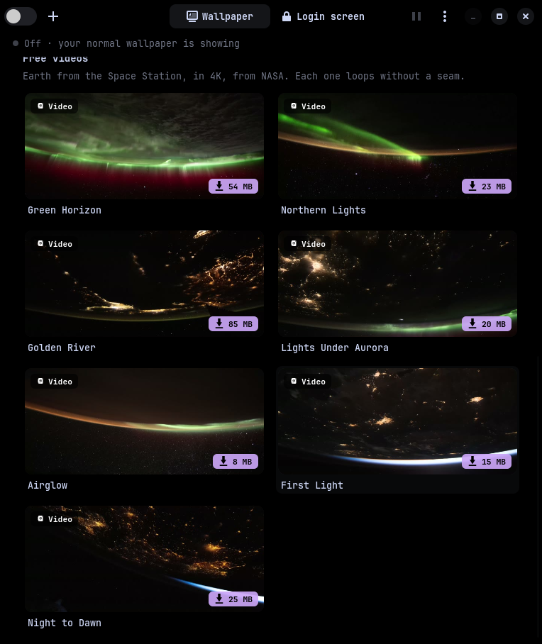
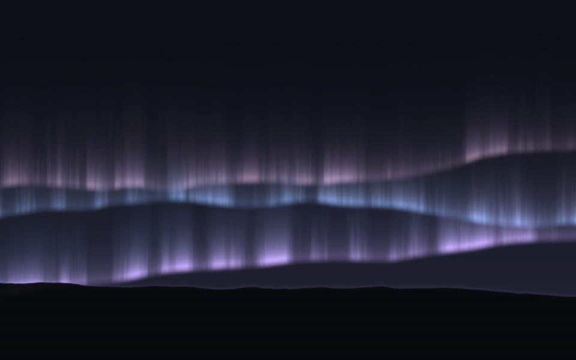
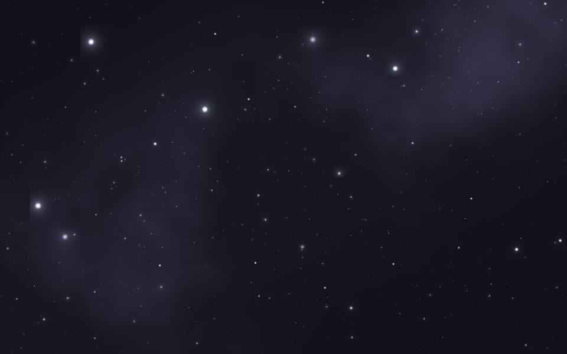
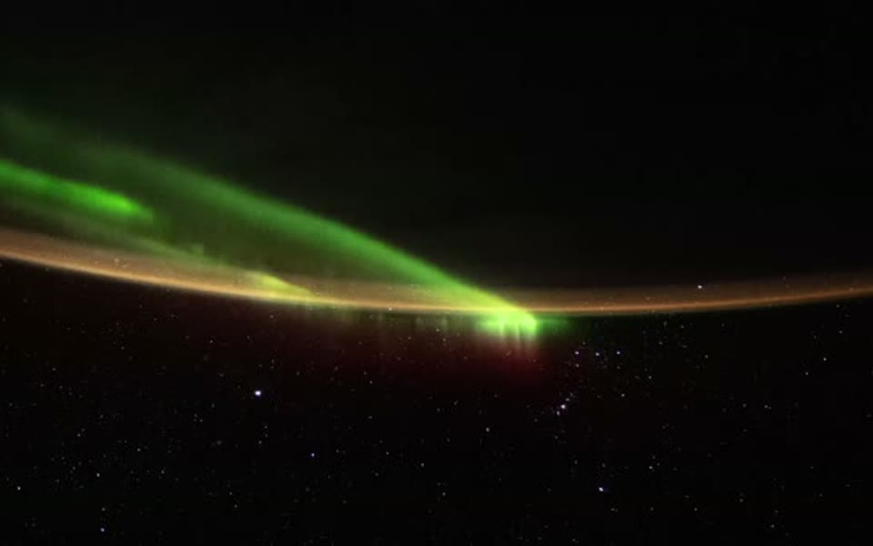
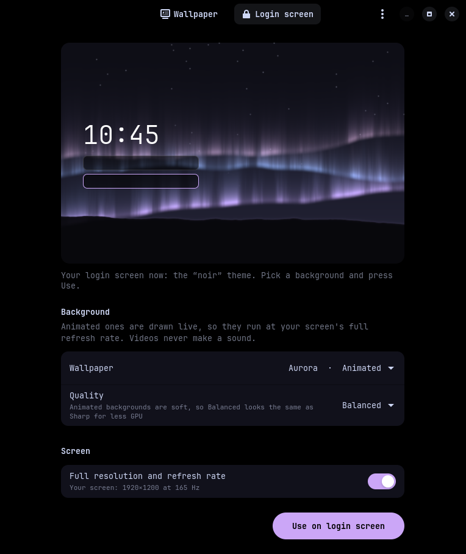

# Mural

Live wallpapers for Linux. Animated wallpapers, videos and images, behind your windows and on
your login screen, on whatever desktop you run.



- **Animated wallpapers** that take their colours from your theme (pywal, or a [wire](https://github.com/dork40/hyprland-rice) rice), so they match the rest of your desktop
- **Free 4K videos**: seven looping clips of Earth at night from the Space Station (NASA, public
  domain), one click each
- **Your own videos** that loop without a hitch and never make a sound
- **Images**: JPG, PNG, WebP, AVIF, HEIC, JPEG XL, and animated GIFs
- **Login screen too**: put any of them behind your SDDM login, at your screen's full resolution
  and refresh rate
- **Gets out of the way.** It pauses by itself for games, fullscreen apps and GameMode, and on
  battery if you want. Paused means no CPU or GPU use at all.
- A different wallpaper on each screen, if you like

| | | |
|---|---|---|
|  Aurora |  Nebula |  Liquid Glass |
|  Starfield |  Soft Gradient |  free NASA videos |

## Install

Arch and Arch-based:

```sh
curl -sL dork40.github.io/mural | bash
```

Fedora, Ubuntu, Debian, openSUSE:

```sh
curl -fsSL https://raw.githubusercontent.com/dork40/mural/main/install.sh | bash
```

Then open **Mural** from your app menu.

## Using it

- Click a wallpaper to put it on your desktop.
- Hover an animated one to see it move.
- **Free videos** at the bottom: click one to download it (8–85 MB). It then sits with your own
  videos.
- **+** (or drag files onto the window) adds your own videos and images. Right-click one to
  remove it.
- The switch at the top left turns Mural on and off. Off means your normal wallpaper is back.
- The pause button freezes the wallpaper. The line under the title tells you if it paused by
  itself, and why.
- With more than one screen, pick the screen at the top left before you click a wallpaper.
- **Preferences** (in the menu): match your theme's colours, smoothness, when to pause, and
  starting with your desktop.

## Login screen



The **Login screen** tab puts a Mural wallpaper behind your login box: pick one, press **Use on
login screen**, type your password. Animated ones are drawn live by your graphics card, so they
move at your screen's full refresh rate. **Full resolution and refresh rate** also gets the login
screen off 60 Hz and onto your screen's best mode. **Put my old login screen back** undoes it.

This works where SDDM is the login screen (KDE, and most Arch and Hyprland setups).

## Where it works

Tested on Hyprland, Sway, i3, KDE Plasma, XFCE and GNOME. It should also work on niri, river,
Wayfire, labwc, Openbox and other X11 desktops. On GNOME, Mural adds a small Shell extension;
log out and back in once after installing.

## How heavy is it?

Measured on a Ryzen laptop with a Radeon RX 7700S, 1920×1200:

| | CPU | GPU |
|---|---|---|
| Animated | ~3% | 4–8% |
| 1080p video | ~4% | hardware decode |
| Image | 0% | 0% |
| Paused | 0% | 0% |
| Animated login screen, 165 Hz | ~0% | ~14% (only while you're on it) |

## License

GPL-3.0-or-later. The built-in animated wallpapers are original. The videos are cut from NASA's
public-domain "Earth in 4K" films from the International Space Station; NASA doesn't endorse Mural.
